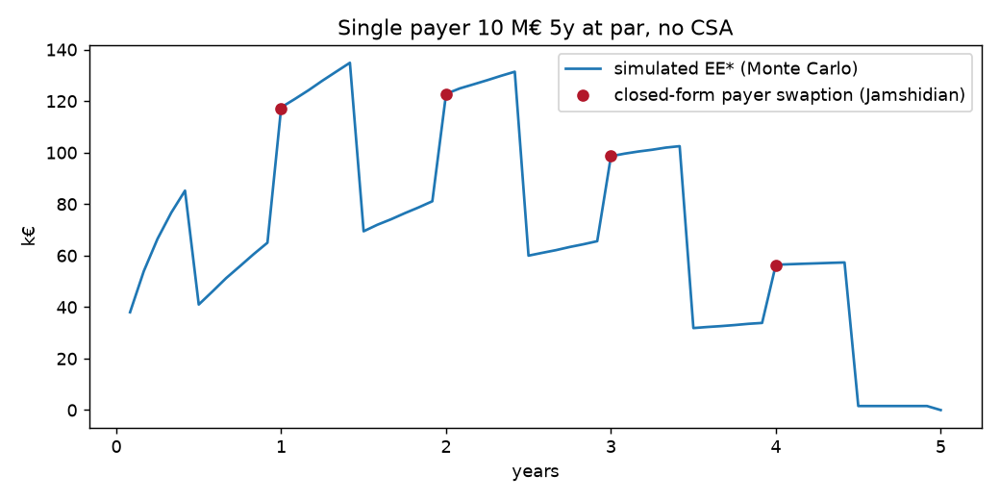
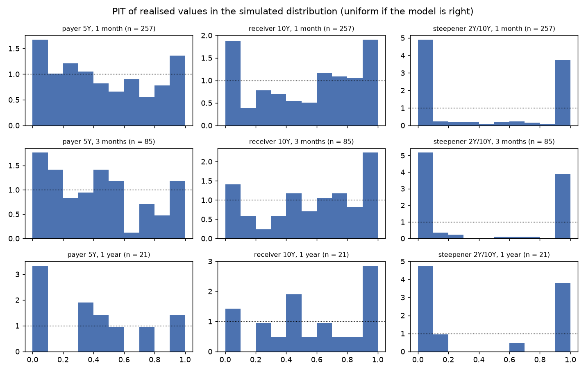

# XVA calculator: CVA, DVA, FVA of a netting set of EUR swaps

Vectorised Hull-White 1F Monte Carlo engine: collateralised exposure profiles, CVA/DVA/FVA,
pre-trade incremental CVA and sensitivities, validated against QuantLib and the closed-form swaption price.

## Progress

| # | Step | Status |
|---|------|--------|
| 1 | Repo, curve interface, HW1F, exact simulation | done (flat curves until project 09) |
| 2 | Jamshidian, Q calibration, P comparison | done |
| — | Plug in the project 09 curves | waiting for 09 |
| 3 | Vectorised 6M IRS / OIS; grid, netting, CSA, metrics | done |
| 4 | Credit, CVA/DVA/FVA, incremental | done |
| 5 | CRN sensitivities, SA-CCR, BA-CVA | done |
| 6 | PIT backtest, convergence, P/Q study | done |
| 7 | Streamlit, GIF; report, README, LinkedIn | done |

## Demo (`app.py`)

Online: https://xva-calculator-dwrrvgykssdappmhxqokdqu.streamlit.app/ (first load ~1 min if the app was asleep). Locally:

```bash
pip install -r requirements.txt
streamlit run app.py
```

XVA of the demo netting set, adjustable CSA (threshold, MTA, MPoR), cost of a new swap in 1 to 3 s on the paths
already simulated, EE/PFE profiles with and without CSA, Euler allocation, proxies shown with their measured impact.
Computed live (about 2 s at start-up, then cached) rather than from precomputed cubes.


Validation report: [`report/validation.pdf`](report/validation.pdf) (self-review, limitations, recommendations;
independent review still to do).

## Curves and the project 09 plug-in (`src/xva/market.py`)

The engine knows a single interface: a callable `t -> P(0, t)`, `t` in ACT/365F years.
A `Market` object carries two curves, `estr` (discounting) and `euribor6m` (projection).

- Until 09 is ready: `sample_market()` returns two flat curves 20 bp apart,
  which already exercises the multi-curve set-up (β ≠ 1).
- At plug-in time: `from_curve_09(curve)` wraps a `Curve` / `CurveHW` from the `ratecurves` package
  (method `P(date)`). It will be enough to build
  `Market(from_curve_09(estr), from_curve_09(euribor6m))` from `ratecurves.curves.estr_curve`
  and `euribor6m_curve`, then add `ratecurves` to the dependencies.
- Left to do at that point: replace the regular year-fraction schedules in `swap_coupons`
  with the TARGET2 dates from 09 (marked `shortcut:` in the code).

## Hull-White 1F (`src/xva/hw1f.py`)

- Closed-form ZC price `P(t, T | x)`, exact joint simulation of `(x, ∫x)` on an irregular grid,
  discount factor `D(0, t) = P(0, t)·exp(-I - V/2)` so `E[D] = P(0, t)` without bias,
  antithetic variates.
- Jamshidian valid for coupons of any sign (the 6M/€STR basis creates small negative coupons).
- Q calibration: `a = 0.03` fixed, `σ` fitted in normal vol to the 10-year co-terminal ATM swaptions
  (`market/swaption_vols.yaml`, **synthetic** for lack of a free source).
- P calibration (comparison only): `σ·B(τ)/τ` fitted to the annualised standard deviations of daily changes
  in the ECB 1, 5 and 10-year spot rates (one year of history, `market/ecb/`).

First figures (flat curves, synthetic vols): σ(Q) = 0.84%, max vol error 3.6 bp;
σ(P) = 0.58%, i.e. **-31%**: a CVA calibrated on history would be understated by about as much.

## Products (`src/xva/products.py`)

- EURIBOR 6M IRS (deterministic 6M/€STR basis) and €STR OIS, payer or receiver, spot or forward start.
- `value(trades, model, market, t, x_t, D_t, state)`: the `value(t, state)` interface where the neural pricer
  will plug in. Each date = one ZC matrix (paths × maturities) × one weight matrix
  (maturities × trades); only the current coupon, fixed on the path, is added trade by trade.
- `cube_mtm`: MtM cube paths × dates × trades, kept for incremental CVA.
- Fix to the project sheet: the running €STR leg is worth `exp(∫_s^t r) − P(t, e)`, not `exp(∫r)·P(t, e) − P(t, e)`
  (error caught by the martingale test).
- No seasoned trades yet (past fixings): to add with the fixings from 09.

## Exposure (`src/xva/exposure.py`)

- Grid: monthly ∪ cash-flow dates ∪ `t − MPoR` nodes.
- Classic collateral `C(t) = max(V(t−M) − H_C, 0) − max(−V(t−M) − H_B, 0)`, MTA added to the thresholds
  (documented approximation), cash flows during the MPoR ignored.
- EE, NEE, PFE 97.5%, discounted EE* and NEE* with standard errors, EEPE (effective EE over one year).

Demo netting set (`portfolios/demo.yaml`, 7 fictitious swaps, 435 M€ notional, Q-calibrated σ, 10,000 paths,
240 dates, cube in 4 s on a PC):

| | EEPE | Max EE | Max PFE |
|---|---|---|---|
| No CSA | 6.2 M€ | 9.3 M€ | 36.8 M€ |
| CSA (H = 10 M€, MTA 0.5 M€, MPoR 10 d) | 5.3 M€ | 5.4 M€ | 13.9 M€ |

## Credit and XVA (`src/xva/xva.py`)

- Survival: piecewise-constant λ bootstrapped on 1, 3, 5, 7, 10-year CDS spreads, R = 40%,
  MidPoint convention (default mid-period, accrued coupon paid at default), regular quarterly CDS
  (no IMM dates). **Synthetic** spreads in `market/spreads.yaml` (BBB counterparty, A-rated bank).
- CVA, DVA, FCA, FBA per the project sheet formulas, EE* at the middle of each interval by trapezoid.
  Funding: `ℓ = max(s_F − (1 − R_B)·λ_B, 0)`, so FBA does not double-count DVA.
- Standard errors computed per antithetic pair.
- `pre_trade`: ΔXVA of a new trade on the same paths, only its MtM is computed.
- `allocation_euler`: marginal CVA per trade (uncollateralised), exact sum = CVA.

```bash
python -m xva.demo
```

Demo netting set, Q-calibrated σ, 10,000 paths (k€, standard error in brackets):

| | CVA | DVA | FCA | FBA | Adjusted value (V0 = 5,090) |
|---|---|---|---|---|---|
| No CSA | 659.7 (3.2) | 227.8 (2.4) | 81.2 (0.3) | 34.2 (0.4) | 4,609.1 |
| CSA | 446.3 (0.7) | 159.5 (1.1) | 57.0 (< 0.1) | 23.5 (0.2) | 4,767.7 |

The CSA removes 32% of the CVA. Euler allocation (no CSA): IRS-01 394 k€, IRS-03 126 k€, IRS-05 103 k€.
Pre-trade for a 50 M€ 10-year payer IRS at 2.60%: ΔCVA = 146.5 k€ (SE 0.9) without CSA, 28.0 k€ (SE 0.2) with CSA,
in 1.4 to 1.6 s.

## Sensitivities and capital (`src/xva/risk.py`)

- Deltas: 1 bp bump to the zero rates of both curves, as triangles at the 1, 2, 5, 10, 30-year pillars
  (they sum to the parallel bump), central, **same draws** (common random numbers), σ recalibrated at each bump.
- Vega: swaption vols ±1% relative, σ recalibrated, same draws.
- CS01: counterparty CDS spreads ±1 bp per pillar, re-bootstrap, same exposures (no resimulation).
- SA-CCR rates (CRE52): one EUR hedging set, buckets < 1, 1-5, > 5 years, delta ±1, margined and unmargined MF,
  multiplier, margined EAD capped by the unmargined one.
- Reduced BA-CVA (MAR50): `K = 0.65·√[(0.5·ΣSCVA)² + 0.75·ΣSCVA²]`. Approximations: effective maturity
  = notional-weighted residual maturity (floor 1 year); RWs copied for a few sectors
  (demo counterparty: IG industrials, 3%), to be checked against MAR50.16 before publication.

Demo netting set with CSA, 10,000 paths, € per +1 bp (standard error in brackets), 46 s for 14 revaluations:

| Bump | 1Y | 2Y | 5Y | 10Y | Parallel |
|---|---|---|---|---|---|
| CVA delta | −62 | −589 | −1,007 | 4,725 | 3,068 (26) |

| CDS pillar | 1Y | 3Y | 5Y | 7Y | 10Y | Parallel |
|---|---|---|---|---|---|---|
| CVA CS01 | 17 | 92 | 289 | 1,055 | 1,300 | 2,754 (3) |

Sum of pillar deltas = parallel to within 1 €, same for the CS01s. CVA vega (+1% of vols): 1,123 €.
Standard errors stay below 1% of the sensitivity thanks to common draws.

Capital: SA-CCR EAD 16.9 M€ (add-on 7.0 M€, RC 5.1 M€), reduced BA-CVA 1.29 M€, against an accounting CVA of 0.66 M€.
With the demo CSA (10 M€ threshold), RC = threshold + MTA = 10.5 M€: the margined EAD (17.6 M€) exceeds the unmargined one
and is capped. A high-threshold CSA does not reduce SA-CCR capital.

## Validation (`src/xva/validation.py`, `python -m xva.report`)

`pip install -e .[report]` then `python -m xva.report` (a few minutes): CSV tables and figures in `report/`.

**Convergence** (demo netting set, no CSA): standard error in `N^-0.504`, antithetics divide the variance
by 4.1 (i.e. 4 times fewer paths). 10,000 paths: CVA 653.0 k€ (SE 3.1), 1.4 s; 50,000: 655.5 k€ (SE 1.4), 6.6 s.


**EE* against the closed-form swaption** (single 10 M€ 5-year payer at par, 40,000 paths): max error 0.46 bp of notional
at the fixed coupon dates, below the standard error (0.87 bp).



**P measure against Q** (same draws, 10,000 paths, change vs the CVA under Q):

| Case | σ | CVA | Change |
|---|---|---|---|
| Q, implied σ (reference) | 0.84% | 653.0 k€ | |
| P, historical σ (1 year ECB) | 0.58% | 499.5 k€ | −23.5% |
| Vols +20% / −20% | 1.01% / 0.67% | 755.2 / 552.0 k€ | +15.7% / −15.5% |
| a = 0.01 / 0.05 (σ recalibrated) | 0.76% / 0.92% | 649.8 / 655.9 k€ | −0.5% / +0.4% |
| Spreads ±25% | 0.84% | 800.8 / 499.3 k€ | +22.6% / −23.5% |

A CVA computed under P would be a quarter lower: the implied vol premium weighs as much as a 25% shock
to spreads. Mean reversion matters little once σ is recalibrated on the same swaptions.

**Point-in-time backtest of exposures under P**: daily ECB AAA curves 2004-2026 (5,665 days, free ECB
API). At each date, σ(P) calibrated on the previous year (no look-ahead), distribution of the value
at the horizon simulated from that day's curve, PIT = rank of the realised value. Non-overlapping windows.
Three netting sets starting at the horizon: 5-year payer, 10-year receiver, steepener (10-year payer against
2-year receiver of similar DV01). Single AAA curve, the only long and free history.

| Horizon | Windows | KS power (true vol ×1.25) | KS payer 5Y | KS receiver 10Y | KS steepener |
|---|---|---|---|---|---|
| 1 month | 257 | 55% | 0.108 (p 0.005) | 0.127 (p < 0.001) | 0.444 (p < 0.001) |
| 3 months | 85 | 21%, indicative | 0.162 (p 0.02) | 0.153 (p 0.03) | 0.462 (p < 0.001) |
| 1 year | 21 | 10%, indicative | 0.268 (p 0.08) | 0.244 (p 0.14) | 0.416 (p 0.001) |



Reading: on directional positions, PITs pile up at both ends (at 1 month, 6 to 10% of
realisations below the 2.5% quantile instead of 2.5%): historical tails are fatter than the
HW1F Gaussian and σ(P) on a rolling year reacts late to regime changes (2008, 2022).
On the steepener, almost all realisations fall outside the simulated distribution: with a single factor,
2-year and 10-year rates move together and the model sees almost no risk on a DV01-neutral position.
This is the known limit of HW1F; a portfolio exposed to the slope would need a two-factor model.
At 3 months and 1 year, power is too low to conclude; those rows are indicative.

## Tests

```bash
pip install -e .[test]
pytest
```

42 tests, about 1 min:
- HW1F: martingale `E[D] = P(0, t)`, moments of `x` and `∫x`, forward ZC consistency, ZC option and
  Jamshidian swaption against QuantLib 1.44, Jamshidian against Monte Carlo in multi-curve, parity,
  Q and P calibrations recovering a known σ, project 09 adapter.
- Products: multi-curve IRS against QuantLib (< 1e-10 of notional), OIS against QuantLib (1e-8, daily
  TARGET compounding); `E[D·V(t)]` = value of remaining cash flows, including mid-period;
  EE* of a single payer = swaption on the residual swap (± 3 SE); PFE within the binomial CI of the closed-form quantile.
- Exposure: sub-additive netting, mirror swaps → 0, infinite threshold = uncollateralised, perfect collateral
  at zero MPoR → 0, EE increasing in MPoR and √MPoR law (± 15% away from cash-flow dates), demo with and without CSA.
- XVA: the bootstrap reprices the spreads; par spread against QuantLib `MidPointCdsEngine` (< 0.1 bp;
  the project sheet's `IsdaCdsEngine` replaced by MidPoint, the engine's convention); CVA of a single swap = sum
  of closed-form swaptions (< 2% and 3 SE); sum of Euler allocations = CVA; pre-trade = full recompute;
  bank CVA = counterparty DVA; ℓ = 0 → no FVA.
- Risk: triangles summing to 1; sum of pillar deltas = parallel (< 5%); delta and vega signs
  of a payer; sum of CS01s = parallel; SA-CCR by hand (one trade, two buckets with multiplier, margined,
  cap); reduced BA-CVA by hand (one and two counterparties).
- Validation: uniform PITs (KS not rejected) when realised curves are drawn from the model itself;
  KS power at nominal level with no misspecification and increasing with the number of windows; convergence slope −0.5.
- App: starts without error, with and without CSA (`streamlit.testing`).
