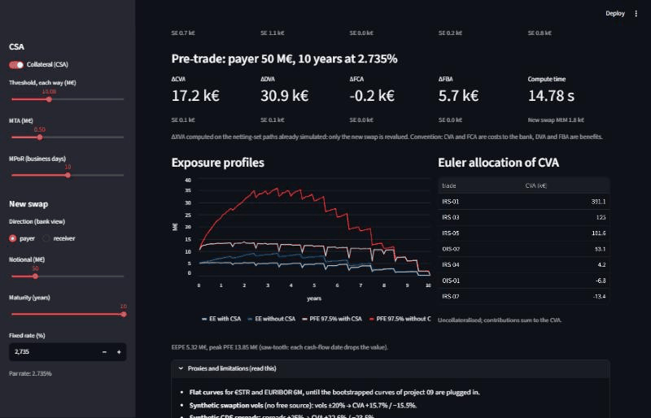
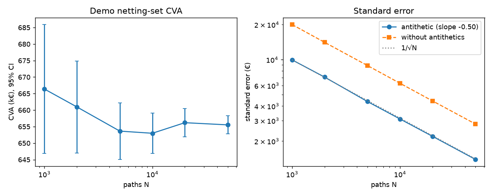
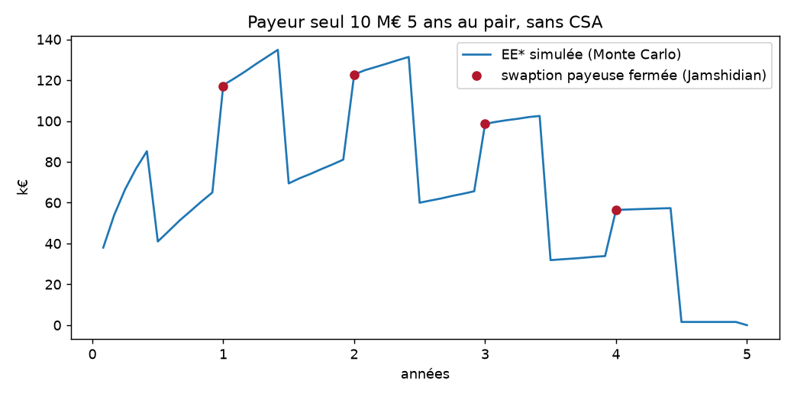

# Calculateur XVA : CVA, DVA, FVA d'un netting set de swaps EUR

Moteur Monte Carlo Hull-White 1F vectorisé : profils d'exposition collatéralisés, CVA/DVA/FVA,
CVA incrémentale pré-trade et sensibilités, validé contre QuantLib et la formule fermée des swaptions.

Fiche projet : `projets-cv/fiches/pdf/05-calculateur-xva.pdf` (dossier Application Linkedin).

## Avancement

| # | Étape | État |
|---|-------|------|
| 1 | Dépôt, interface de courbe, HW1F, simulation exacte | fait (courbes plates en attendant la 09) |
| 2 | Jamshidian, calibration Q, comparaison P | fait |
| — | Greffe des courbes de la fiche 09 | en attente de la 09 |
| 3 | IRS 6M / OIS vectorisés ; grille, netting, CSA, métriques | fait |
| 4 | Crédit, CVA/DVA/FVA, incrémentale | fait |
| 5 | Sensibilités CRN, SA-CCR, BA-CVA | fait |
| 6 | Backtest PIT, convergence, étude P/Q | fait |
| 7 | Streamlit, GIF ; rapport, README, LinkedIn | fait |

## Démo (`app.py`)

Sans serveur : https://louisdelacour21.github.io/xva-calculator/ (le même moteur Python dans le navigateur via Pyodide, `index.html` + `web/` ; 30 s à 1 min au premier chargement, puis quelques secondes par réglage).

En ligne : https://xva-calculator-aqs3w2xdkgad2z9vhmndxt.streamlit.app/ (premier chargement ~1 min si l'appli dormait). En local :

```bash
pip install -r requirements.txt
streamlit run app.py
```

XVA du netting set démo, CSA réglable (seuil, MTA, MPoR), coût d'un nouveau swap en 1 à 3 s sur les chemins déjà
simulés, profils EE/PFE avec et sans CSA, allocation d'Euler, proxys affichés avec leur impact chiffré.
Calcul en direct (environ 2 s au démarrage, puis mis en cache) plutôt que des cubes précalculés.



Rapport de validation : [`rapport/validation.pdf`](rapport/validation.pdf) (auto-revue, limites, recommandations ;
relecture par un tiers à faire).

## Courbes et greffe de la fiche 09 (`src/xva/market.py`)

Le moteur ne connaît qu'une interface : un appelable `t -> P(0, t)`, `t` en années ACT/365F.
Un objet `Marche` porte deux courbes, `estr` (actualisation) et `euribor6m` (projection).

- En attendant la 09 : `marche_test()` donne deux courbes plates séparées d'une base de 20 bp,
  ce qui exerce déjà le multi-courbes (β ≠ 1).
- À la greffe : `depuis_courbe_09(courbe)` enveloppe une `Courbe` / `CourbeHW` du paquet `courbes-taux`
  (méthode `P(date)`). Il suffira de construire
  `Marche(depuis_courbe_09(estr), depuis_courbe_09(euribor6m))` à partir de `courbes.curves.courbe_estr`
  et `courbe_euribor6m`, puis d'ajouter `courbes-taux` aux dépendances.
- Reste à faire à ce moment-là : remplacer les échéanciers réguliers en années de `swap_coupons`
  par les dates TARGET2 de la 09 (marqué `shortcut:` dans le code).

## Hull-White 1F (`src/xva/hw1f.py`)

- Prix ZC fermé `P(t, T | x)`, simulation exacte jointe de `(x, ∫x)` sur grille irrégulière,
  facteur d'actualisation `D(0, t) = P(0, t)·exp(-I - V/2)` donc `E[D] = P(0, t)` sans biais,
  variables antithétiques.
- Jamshidian valable pour des coupons de signe quelconque (la base 6M/€STR crée de petits coupons négatifs).
- Calibration Q : `a = 0,03` fixé, `σ` ajusté en vol normale sur les swaptions ATM co-terminales 10 ans
  (`market/swaption_vols.yaml`, **synthétique** faute de source gratuite).
- Calibration P (comparaison uniquement) : `σ·B(τ)/τ` ajusté aux écarts-types annualisés des variations
  quotidiennes des taux spot BCE 1, 5 et 10 ans (un an d'historique, `market/bce/`).

Premiers chiffres (courbes plates, vols synthétiques) : σ(Q) = 0,84 %, écart de vol max 3,6 bp ;
σ(P) = 0,58 %, soit **-31 %** : une CVA calibrée sur l'historique serait sous-estimée d'environ autant.

## Produits (`src/xva/products.py`)

- IRS EURIBOR 6M (base 6M/€STR déterministe) et OIS €STR, payeur ou receveur, démarrage immédiat ou à terme.
- `valeur(trades, modèle, marché, t, x_t, D_t, état)` : l'interface `value(t, state)` où se branchera
  le pricer neuronal. Chaque date = une matrice de ZC (chemins × échéances) × une matrice de poids
  (échéances × trades) ; seul le coupon en cours, fixé sur le chemin, est ajouté trade par trade.
- `cube_mtm` : cube MtM chemins × dates × trades, conservé pour la CVA incrémentale.
- Correction de la fiche : la jambe €STR en cours vaut `exp(∫_s^t r) − P(t, e)`, pas `exp(∫r)·P(t, e) − P(t, e)`
  (erreur détectée par le test de martingale).
- Pas encore de trade déjà vivant (fixings passés) : à ajouter avec les fixings de la 09.

## Exposition (`src/xva/exposure.py`)

- Grille : mensuelle ∪ dates de flux ∪ nœuds `t − MPoR`.
- Collatéral classique `C(t) = max(V(t−M) − H_C, 0) − max(−V(t−M) − H_B, 0)`, MTA ajouté aux seuils
  (approximation écrite), flux pendant la MPoR ignorés.
- EE, NEE, PFE 97,5 %, EE* et NEE* actualisés avec erreurs-types, EEPE (EE effective sur un an).

Portefeuille démo (`portfolios/demo.yaml`, 7 swaps fictifs, 435 M€ de nominal, σ calibré Q, 10 000 chemins,
240 dates, cube en 4 s sur le PC) :

| | EEPE | EE max | PFE max |
|---|---|---|---|
| Sans CSA | 6,2 M€ | 9,3 M€ | 36,8 M€ |
| CSA (H = 10 M€, MTA 0,5 M€, MPoR 10 j) | 5,3 M€ | 5,4 M€ | 13,9 M€ |

## Crédit et XVA (`src/xva/xva.py`)

- Survie : λ constante par morceaux bootstrapée sur les spreads CDS 1, 3, 5, 7, 10 ans, R = 40 %,
  convention MidPoint (défaut au milieu de la période, coupon couru payé au défaut), CDS trimestriels réguliers
  (pas de dates IMM). Spreads **synthétiques** dans `market/spreads.yaml` (contrepartie BBB, banque A).
- CVA, DVA, FCA, FBA selon les formules de la fiche, EE* au milieu de chaque intervalle par trapèze.
  Financement : `ℓ = max(s_F − (1 − R_B)·λ_B, 0)`, donc la FBA ne recompte pas la DVA.
- Erreurs-types calculées par paire antithétique.
- `pre_trade` : ΔXVA d'un nouveau trade sur les mêmes chemins, seul son MtM est calculé.
- `allocation_euler` : CVA marginale par trade (sans collatéral), somme exacte = CVA.

```bash
python -m xva.demo
```

Portefeuille démo, σ calibré Q, 10 000 chemins (k€, erreur-type entre parenthèses) :

| | CVA | DVA | FCA | FBA | V ajustée (V0 = 5 090) |
|---|---|---|---|---|---|
| Sans CSA | 659,7 (3,2) | 227,8 (2,4) | 81,2 (0,3) | 34,2 (0,4) | 4 609,1 |
| CSA | 446,3 (0,7) | 159,5 (1,1) | 57,0 (< 0,1) | 23,5 (0,2) | 4 767,7 |

Le CSA retire 32 % de la CVA. Allocation d'Euler (sans CSA) : IRS-01 394 k€, IRS-03 126 k€, IRS-05 103 k€.
Pré-trade d'un IRS payeur 50 M€ 10 ans à 2,60 % : ΔCVA = 146,5 k€ (ET 0,9) sans CSA, 28,0 k€ (ET 0,2) avec CSA,
en 1,4 à 1,6 s.

## Sensibilités et capital (`src/xva/risk.py`)

- Deltas : choc de 1 bp sur les taux zéro des deux courbes, en triangles aux piliers 1, 2, 5, 10, 30 ans
  (leur somme est le choc parallèle), centré, **mêmes tirages** (nombres aléatoires communs), σ recalibré à chaque choc.
- Vega : vols de swaptions ±1 % relatif, σ recalibré, mêmes tirages.
- CS01 : spreads CDS de la contrepartie ±1 bp par pilier, re-bootstrap, mêmes expositions (pas de resimulation).
- SA-CCR taux (CRE52) : un hedging set EUR, buckets < 1, 1-5, > 5 ans, delta ±1, MF margé et non margé,
  multiplicateur, plafond de l'EAD margée par la non margée.
- BA-CVA réduit (MAR50) : `K = 0,65·√[(0,5·ΣSCVA)² + 0,75·ΣSCVA²]`. Approximations : maturité effective
  = maturité résiduelle pondérée par les nominaux (plancher 1 an) ; RW recopiés pour quelques secteurs
  (contrepartie démo : industrie IG, 3 %), à revérifier contre MAR50.16 avant publication.

Portefeuille démo avec CSA, 10 000 chemins, € pour +1 bp (erreur-type entre parenthèses), 46 s pour 14 réévaluations :

| Choc | 1Y | 2Y | 5Y | 10Y | Parallèle |
|---|---|---|---|---|---|
| Delta CVA | −62 | −589 | −1 007 | 4 725 | 3 068 (26) |

| Pilier CDS | 1Y | 3Y | 5Y | 7Y | 10Y | Parallèle |
|---|---|---|---|---|---|---|
| CS01 CVA | 17 | 92 | 289 | 1 055 | 1 300 | 2 754 (3) |

Somme des deltas par pilier = parallèle à 1 € près, idem pour les CS01. Vega CVA (+1 % des vols) : 1 123 €.
Les erreurs-types restent sous 1 % de la sensibilité grâce aux tirages communs.

Capital : EAD SA-CCR 16,9 M€ (add-on 7,0 M€, RC 5,1 M€), BA-CVA réduit 1,29 M€, contre une CVA comptable de 0,66 M€.
Avec le CSA démo (seuil 10 M€), RC = seuil + MTA = 10,5 M€ : l'EAD margée (17,6 M€) dépasse la non margée
et elle est plafonnée. Un CSA à seuil élevé n'allège pas le capital SA-CCR.

## Validation (`src/xva/validation.py`, `python -m xva.rapport`)

`pip install -e .[rapport]` puis `python -m xva.rapport` (environ 1 min) : tableaux en CSV et figures dans `rapport/`.

**Convergence** (portefeuille démo sans CSA) : erreur-type en `N^-0,504`, les antithétiques divisent la variance
par 4,1 (soit 4 fois moins de chemins). 10 000 chemins : CVA 653,0 k€ (ET 3,1), 1,4 s ; 50 000 : 655,5 k€ (ET 1,4), 6,6 s.



**EE* contre swaption fermée** (payeur seul 10 M€ 5 ans au pair, 40 000 chemins) : écart max 0,46 bp du nominal
aux dates de coupon fixe, sous l'erreur-type (0,87 bp).



**Mesure P contre Q** (mêmes tirages, 10 000 chemins, écart à la CVA sous Q) :

| Cas | σ | CVA | Écart |
|---|---|---|---|
| Q, σ implicite (référence) | 0,84 % | 653,0 k€ | |
| P, σ historique (1 an BCE) | 0,58 % | 499,5 k€ | −23,5 % |
| Vols +20 % / −20 % | 1,01 % / 0,67 % | 755,2 / 552,0 k€ | +15,7 % / −15,5 % |
| a = 0,01 / 0,05 (σ recalibré) | 0,76 % / 0,92 % | 649,8 / 655,9 k€ | −0,5 % / +0,4 % |
| Spreads ±25 % | 0,84 % | 800,8 / 499,3 k€ | +22,6 % / −23,5 % |

Une CVA calculée sous P serait inférieure d'un quart : la prime de vol implicite pèse autant qu'un choc de 25 %
des spreads. Le retour à la moyenne compte peu une fois σ recalibré sur les mêmes swaptions.

**Backtest point-in-time des expositions sous P** : courbes BCE AAA quotidiennes 2004-2026 (5 665 jours, API
gratuite de la BCE). À chaque date, σ(P) calibré sur l'année précédente (pas de look-ahead), loi de la valeur
à l'horizon simulée depuis la courbe du jour, PIT = rang de la valeur réalisée. Fenêtres sans chevauchement.
Trois netting sets démarrant à l'horizon : payeur 5 ans, receveur 10 ans, pentification (payeur 10 ans contre
receveur 2 ans de DV01 voisin). Mono-courbe AAA, seul historique long et gratuit.

| Horizon | Fenêtres | Puissance KS (vol vraie ×1,25) | KS payeur 5Y | KS receveur 10Y | KS pentification |
|---|---|---|---|---|---|
| 1 mois | 257 | 55 % | 0,108 (p 0,005) | 0,127 (p < 0,001) | 0,444 (p < 0,001) |
| 3 mois | 85 | 21 %, indicatif | 0,162 (p 0,02) | 0,153 (p 0,03) | 0,462 (p < 0,001) |
| 1 an | 21 | 10 %, indicatif | 0,268 (p 0,08) | 0,244 (p 0,14) | 0,416 (p 0,001) |


Lecture : sur les positions directionnelles, les PIT s'accumulent aux deux bords (à 1 mois, 6 à 10 % des
réalisations sous le quantile 2,5 % au lieu de 2,5 %) : les queues historiques sont plus épaisses que la
gaussienne HW1F et σ(P) sur un an glissant réagit en retard aux changements de régime (2008, 2022).
Sur la pentification, presque toutes les réalisations tombent hors de la loi simulée : avec un seul facteur,
2 ans et 10 ans bougent ensemble et le modèle ne voit quasiment aucun risque sur une position neutre en DV01.
C'est la limite connue du HW1F ; un portefeuille exposé à la pente demanderait un modèle à deux facteurs.
À 3 mois et 1 an, la puissance est trop faible pour conclure ; ces lignes sont indicatives.

## Tests

```bash
pip install -e .[test]
pytest
```

42 tests, environ 1 min :
- HW1F : martingale `E[D] = P(0, t)`, moments de `x` et `∫x`, cohérence ZC futur, option sur ZC et
  swaption Jamshidian contre QuantLib 1.44, Jamshidian contre Monte Carlo en multi-courbes, parité,
  calibrations Q et P retrouvant un σ connu, adaptateur de la fiche 09.
- Produits : IRS multi-courbes contre QuantLib (< 1e-10 du nominal), OIS contre QuantLib (1e-8, capitalisation
  TARGET jour par jour) ; `E[D·V(t)]` = valeur des flux restants, y compris en milieu de période ;
  EE* d'un payeur seul = swaption sur le swap résiduel (± 3 ET) ; PFE au quantile fermée dans l'IC binomial.
- Exposition : netting sous-additif, swaps miroirs → 0, seuil infini = sans collatéral, collatéral parfait
  à MPoR nulle → 0, EE croissante en MPoR et loi √MPoR (± 15 % hors dates de flux), démo avec et sans CSA.
- XVA : le bootstrap reprice les spreads ; spread au pair contre QuantLib `MidPointCdsEngine` (< 0,1 bp ;
  `IsdaCdsEngine` de la fiche remplacé par MidPoint, la convention du moteur) ; CVA d'un swap seul = somme
  de swaptions fermées (< 2 % et 3 ET) ; somme des allocations d'Euler = CVA ; pré-trade = recalcul complet ;
  CVA de la banque = DVA de la contrepartie ; ℓ = 0 → pas de FVA.
- Risque : triangles de somme 1 ; somme des deltas par pilier = parallèle (< 5 %) ; signes de delta et vega
  d'un payeur ; somme des CS01 = parallèle ; SA-CCR à la main (un trade, deux buckets avec multiplicateur, margé,
  plafond) ; BA-CVA réduit à la main (une et deux contreparties).
- Validation : PIT uniformes (KS non rejeté) quand les courbes réalisées sont tirées du modèle lui-même ;
  puissance du KS au niveau nominal sans écart et croissante avec le nombre de fenêtres ; pente de convergence −0,5.
- Appli : démarre sans erreur, avec et sans CSA (`streamlit.testing`).
